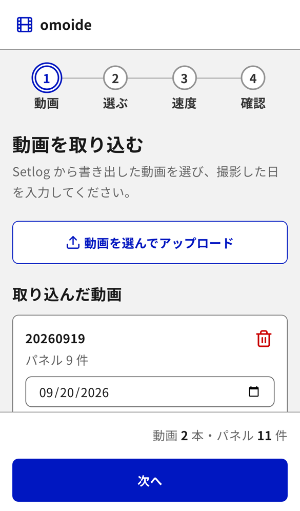
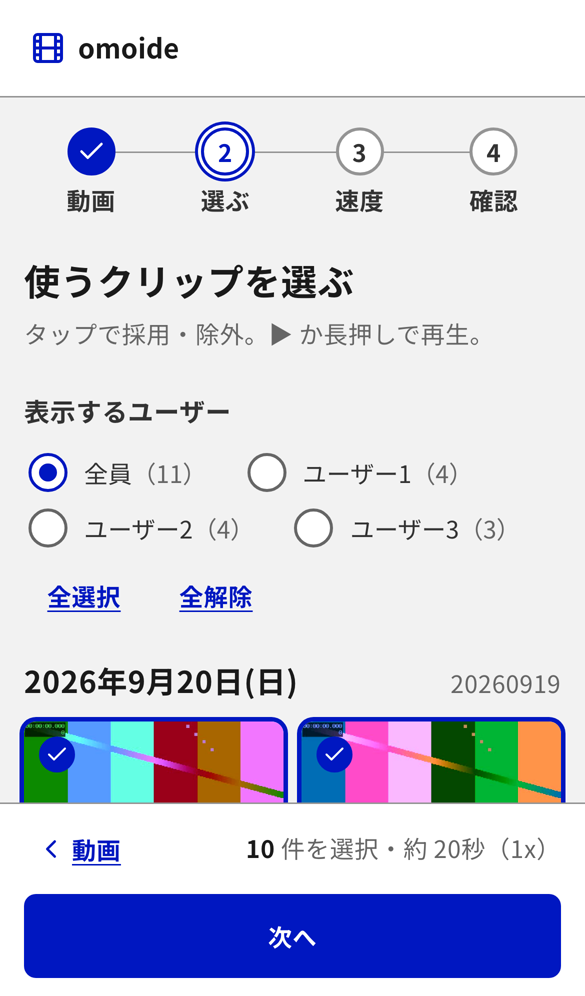
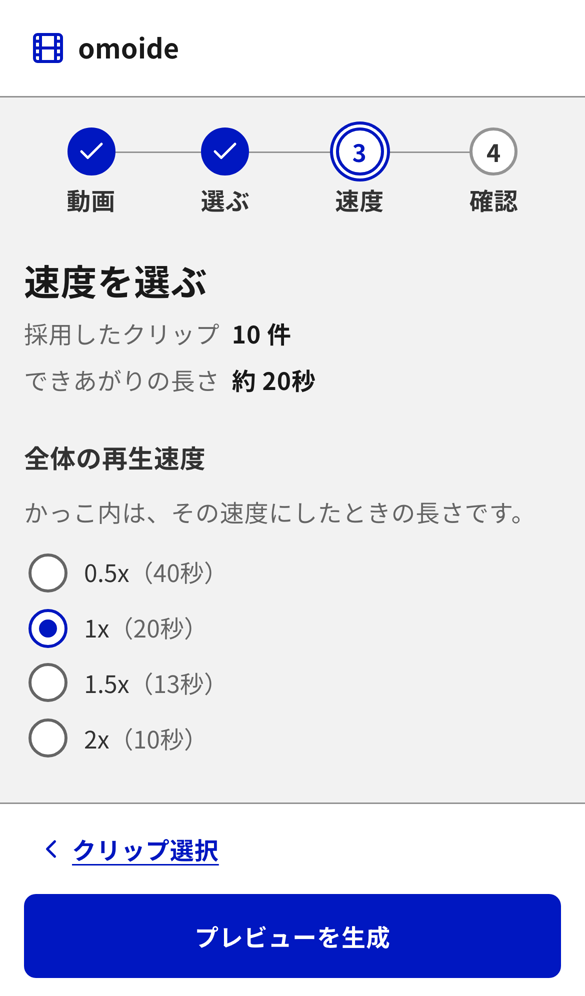
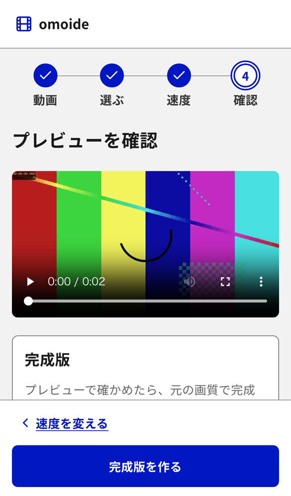

# omoide

Setlogの書き出し動画を、スマホで選んで1本にまとめるツール。動画はMacに置いたまま、自動でクリップに分割する。同じWi-Fiのスマホから使うクリップを選び、速度を決めてプレビューし、完成版をダウンロードする。

- **Mac**：動画の保存・解析・変換・配信（Python、FFmpeg）
- **スマホ**：クリップの選択とプレビュー（ブラウザ、React）

スマホの画面は次の4つの手順で進む。写真は、E2Eテストのモックのデータで撮った。

| 1. 動画 | 2. 選ぶ | 3. 速度 | 4. 確認 |
| --- | --- | --- | --- |
|  |  |  |  |

## ダウンロードして使う

Python・Node.js・FFmpegを入れなくても使える。

1. [Releases](https://github.com/knk1313/omoide/releases)から、自分のOSのzipをダウンロードする
   - Mac（Apple Silicon）：`omoide-macos-arm64.zip`
   - Windows：`omoide-windows-x64.zip`
   - Linux：`omoide-linux-x64.zip`
2. zipを展開し、`omoide`フォルダの`omoide`（Windowsは`omoide.exe`）をダブルクリックする
3. 開いた窓で、スマホで入力するパスワードを決める
4. 表示されたQRコードを、同じWi-Fiにつないだスマホのカメラで読み取る

署名していないアプリなので、初めて開くときはOSが起動を止める。

- Mac：「システム設定」→「プライバシーとセキュリティ」の下の方にある「このまま開く」を押し、もう一度「開く」を押す
- Windows：「WindowsによってPCが保護されました」と出たら、「詳細情報」→「実行」を押す。ファイアウォールの確認が出たら、プライベートネットワークを許可する

取り込んだ動画と作った動画は、はじめは`omoide`フォルダの`input`・`output`に置かれる。保存先は、スマホの画面の「設定」（右上の歯車）で変えられる。変えると、次に起動したときに今のファイルを新しい場所へ移す。同じ画面の「すべてのデータを消す」で、保存先の動画・完成版・作業用ファイルをまとめて消せる。zipには、FFmpeg（GPL版）が含まれる。ライセンスと入手先は、zipの中の`THIRD_PARTY_NOTICES.txt`に書いた。

## 開発環境で動かす

- macOS（Python 3.13、FFmpeg）
- 画面をビルドするときだけNode.js 24
- スマホはiPhoneのSafariかAndroidのChrome。Macと同じWi-Fiにつなぐ

### 使い方

```bash
# 初回のみ (FFmpeg が必要: brew install ffmpeg)
python3 -m venv .venv
.venv/bin/pip install -r requirements.txt

# input/ に Setlog の書き出し動画 (MP4 / MOV) を置いて実行
.venv/bin/python main.py scan            # クリップと中身のあるパネルを一覧表示
.venv/bin/python main.py scan --export   # 中身のあるパネルを output/<動画名>/ に書き出す

# パネルをつないで 1 本の動画にする (output/omoide-<日時>.mp4)
.venv/bin/python main.py join --speed 1.5                     # 除外していない、中身のあるパネルをすべて使う
.venv/bin/python main.py join --select collection_export/001-1,collection_export/002-3

# 同じ Wi-Fi のスマホから操作するサーバーを起動する (先に画面をビルドしておく: cd web && npm run build)
# 起動するとパスワードを聞かれ、URL と QR コードが表示される。既定では 2 時間で終了する
# 動画はスマホからアップロードでき、input/ に置いた動画も読み込む
.venv/bin/python main.py serve --expires 2h

# input/ の動画と、そこから作った生成物（output/ と .setlog-join/）をまとめて消す
# 消す対象と大きさを表示し、確認してから消す（--yes で確認を省く）。serve は先に止めておく
.venv/bin/python main.py clean
```

- 動画は、メタデータの作成日時（無ければファイルの更新日時）の順に並べる
- 約2秒ごとのクリップの境目を検出する
- 縦に3段並んだカードを検出し、余白と角丸を除いて切り出す
- 時刻と「zZ」だけの空のカードは除外する
- `join`は、上の人の全クリップ（時系列）、中の人、下の人の順につなぐ。速度は`0.5`、`1`、`1.5`、`2`から選ぶ

解析結果は`.setlog-join/cache/`に保存する。動画のファイルサイズと更新日時が変わらなければ、次回は解析を省く。`scan`は、中身のあるパネルごとのサムネイル（幅640pxのJPEG）も`.setlog-join/thumbnails/`に作る。

採用・除外と速度は`.setlog-join/projects/project.json`に保存する。`join`は、`--select`と`--speed`を省略すると、この内容を使う。

`input/`・`output/`・`.setlog-join/`の中身は、Gitで管理しない。開発環境ではいつもこの3つを使い、保存先は変えられない。`clean`とスマホの「すべてのデータを消す」も、この3つを対象にする。単体アプリでは、`clean`は設定した保存先を対象にする。

## 使うときの注意

- `serve`は、同じWi-Fiのスマホから見られるサーバーをMacで開く。自宅など信頼できるネットワークで使い、カフェや駅などの公衆Wi-Fiでは使わない
- サーバーは、起動時に決めるパスワード、QRコードのURL、有効期限（既定は2時間）で守る。詳しくは[docs/security.md](docs/security.md)を参照
- 動画はMacの中だけで扱い、外部のサービスには送らない
- Setlogの書き出し動画を前提にした個人用のツールで、Setlogとは関係がない

## 構成

```text
.
├── main.py          # CLI の入口
├── setlog_join/     # 動画の解析・切り出し (Python)
├── tests/           # Python のテスト
├── web/             # スマホ向け UI (Vite + React + TypeScript + Tailwind CSS)
├── input/           # 入力動画を置く
└── output/          # 書き出し先
```

```bash
# Python のテスト
.venv/bin/python -m unittest discover -s tests
```

### 単体アプリを作る

`v`で始まるタグをpushすると、GitHub Actionsが単体アプリを作る。Mac・Windows・Linuxの3つを作り、Releasesに置く（`.github/workflows/release.yml`）。手元のMacで作るときは、次のとおりにする。

```bash
.venv/bin/pip install -r requirements-build.txt
(cd web && npm ci && npm run build)
.venv/bin/python packaging/fetch_ffmpeg.py   # 配る ffmpeg を取得する（手元で試すだけなら --local で PATH の ffmpeg を使う）
.venv/bin/python packaging/build.py          # packaging/dist/omoide-macos-arm64.zip ができる
.venv/bin/python packaging/smoke_test.py packaging/dist/omoide
```

`web/`のUIは、デジタル庁デザインシステム（DADS）に準拠したテンプレート[workspace-ui-template-dads](https://github.com/knk1313/workspace-ui-template-dads)のコミット`5aa8852`（0.4.0）に基づく。開発方法は[web/README.md](web/README.md)を参照。

## ライセンス

[MIT License](LICENSE)
